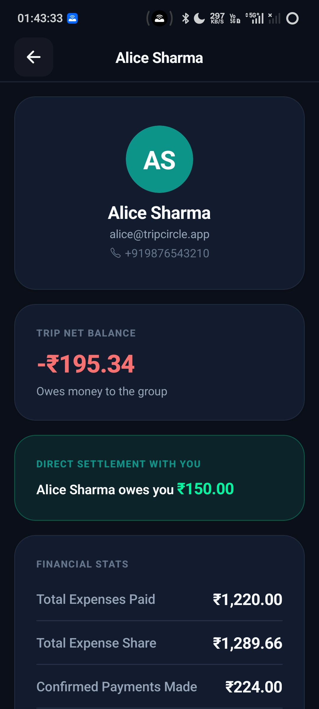

# TripCircle — Financial Model & Exact Accounting Specification

## 1. Monetary Representation: Integer Paise

All currency calculations and storage throughout TripCircle are strictly in **integer paise**:
- ₹100.00 = `10000` paise
- ₹1,586.65 = `158665` paise
- ₹0.01 = `1` paisa

Binary floating-point types (`number` with decimals) are prohibited from authoritative representations.

---

## 2. Invariants & Mathematical Guarantees

### Invariant 1: Allocation Sum Equality
For every expense $E$:
$$\sum_{i=1}^{N} \text{sharePaise}_i = \text{amountPaise}_E$$
Every allocation share must be non-negative: $\text{sharePaise}_i \ge 0$.

### Invariant 2: Zero-Sum Conservation of Value
For any closed group trip containing member expenses, confirmed payments, and accepted settlement discounts:
$$\sum_{m \in \text{TripMembers}} \text{netBalancePaise}_m = 0$$

### Invariant 3: Idempotency of Financial Submissions
Every payment submission supports an optional client-supplied `idempotencyKey`. Repeated submissions with the same key return the existing record without duplicate transactions.

---

## 3. Equal Splitting & Deterministic Remainder Distribution

When dividing an amount $A$ among $N$ beneficiaries:
1. Sort beneficiary identifiers ascending by `memberId`.
2. Compute base integer share:
   $$\text{baseShare} = \lfloor A / N \rfloor$$
3. Compute remainder paise:
   $$R = A \pmod N$$
4. For $i = 0$ to $R - 1$:
   $$\text{share}_i = \text{baseShare} + 1$$
5. For $i = R$ to $N - 1$:
   $$\text{share}_i = \text{baseShare}$$

### Example
Splitting ₹100.00 (`10000` paise) among 3 members:
- `baseShare` = 3333
- `remainder` = 1
- Member 1: 3334 paise (₹33.34)
- Member 2: 3333 paise (₹33.33)
- Member 3: 3333 paise (₹33.33)
- Sum = $3334 + 3333 + 3333 = 10000$ paise (₹100.00). Exact to 0 paise!

---

## 4. Net Balance Derivation

The authoritative net balance for any member $m$ is derived deterministically from the financial ledger:

$$\begin{aligned}
\text{netBalancePaise}_m = & (\text{totalPaidPaise}_m - \text{totalExpenseSharePaise}_m) \\
& + (\text{paymentsMadePaise}_m - \text{paymentsReceivedPaise}_m) \\
& + (\text{discountsReceivedPaise}_m - \text{discountsGivenPaise}_m)
\end{aligned}$$

- **Positive balance ($> 0$):** Member is owed money by the group.
- **Negative balance ($< 0$):** Member owes money to the group.
- **Zero balance ($= 0$):** Member is fully settled.

---

## 5. Settlement Engine: Greedy Debt Simplification Algorithm

To calculate the consolidated payment recommendations:
1. Divide members into **debtors** ($\text{net} < 0$) and **creditors** ($\text{net} > 0$).
2. Sort creditors descending by credit amount (tie-break by `memberId`).
3. Sort debtors descending by absolute debt amount (tie-break by `memberId`).
4. While debtors and creditors remain:
   - Match top debtor $D$ and top creditor $C$.
   - $\text{transferAmount} = \min(D.\text{debt}, C.\text{credit})$
   - Emit transfer: $D \to C$ of $\text{transferAmount}$ paise.
   - $D.\text{debt} \leftarrow D.\text{debt} - \text{transferAmount}$
   - $C.\text{credit} \leftarrow C.\text{credit} - \text{transferAmount}$
   - If $D.\text{debt} = 0$, advance debtor pointer.
   - If $C.\text{credit} = 0$, advance creditor pointer.

### Properties
- Exact integer paise amounts.
- Guaranteed convergence to 0 unsettled balance.
- Deterministic output for identical inputs.
- Never generates zero or negative payment amounts.
- Reconciles 100% with member net balances.

---

## 6. Settlement Discounts

An explicit settlement discount represents a formal waiver of debt:
- Example: Debt is ₹1,586.65 (`158665` paise).
- Debtor pays ₹1,586.00 (`158600` paise).
- Creditor accepts waiving ₹0.65 (`65` paise).
---

## 7. Financial Model In Practice: Live UI Mapping

The exact integer paise model is visually surfaced to users on mobile without exposing raw internal integer representation:

  
  &nbsp;&nbsp;&nbsp;&nbsp;
  

1. **Member Ledger Breakdown (`Individual_Trip_Balance_Profile.jpg`)**:
   - Direct inspection of Alice Sharma's financial standing:
     - **Net Balance:** `-₹195.34` (Owes money to the group).
     - **Direct Bilateral Debt:** Alice Sharma owes you `₹150.00`.
     - **Total Expenses Paid:** `₹1,220.00`
     - **Total Expense Share:** `₹1,289.66`
     - **Confirmed Payments Made:** `₹224.00`
   - Notice that the difference between her out-of-pocket expenses and her liability share is exactly:
     $$₹1,220.00 - ₹1,289.66 = -₹69.66$$
     Factoring in confirmed payments made (`₹224.00`) and received yields her exact net balance of `-₹195.34`.

2. **Chronological Ledger Integrity (`Trip_Ledger.jpg`)**:
   - The ledger presents all 16 transactions chronologically.
   - Verified payments (`UPI · CONFIRMED`) are badged distinctly from category expenses (*Activities & Entertainment: ₹250.00*, *Accommodation: ₹500.00*, *Fuel: ₹250.00*).
   - Direct transfers strictly update balances only after transitioning to `CONFIRMED`. Unconfirmed or disputed payments never affect ledger sums.

