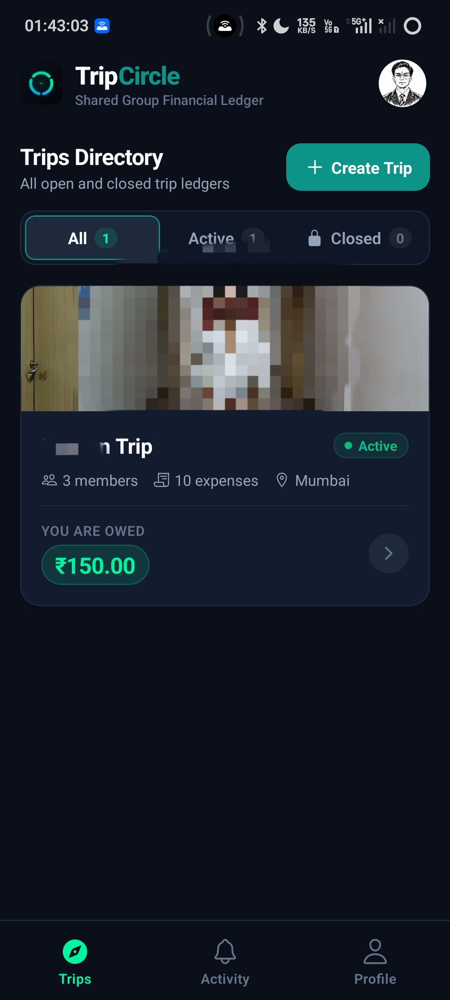
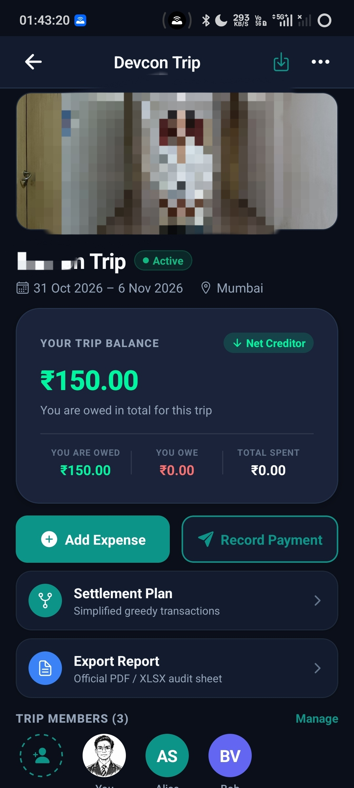
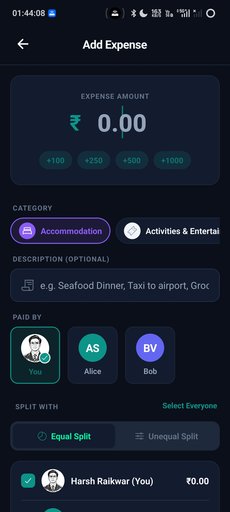
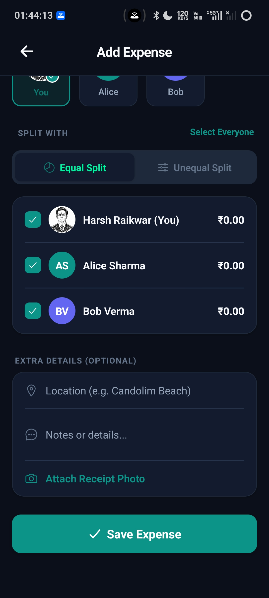
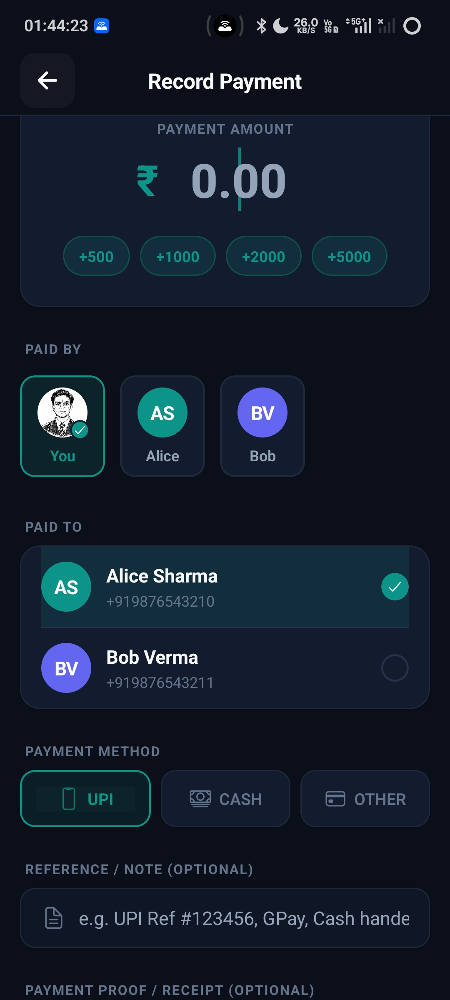
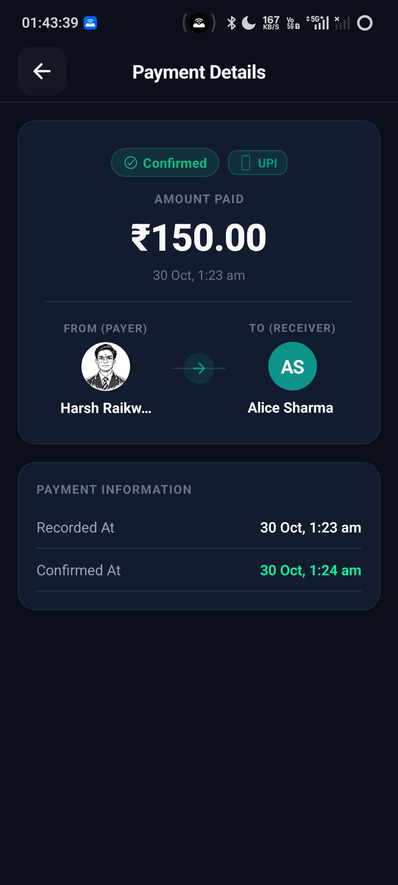
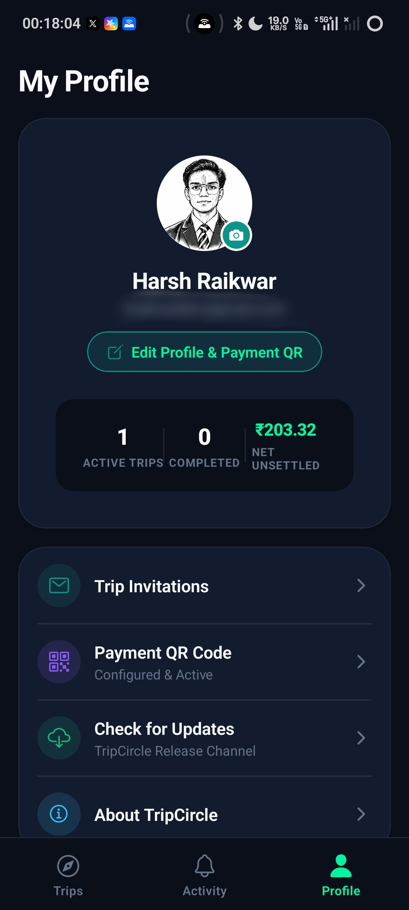

# TripCircle — Application Visual Tour & Screen Anatomy

This guide provides an in-depth walkthrough of the TripCircle mobile application interface, detailing the screen architecture, financial invariants, and interaction patterns illustrated by high-resolution captures from a live Android device.

---

## Table of Contents
1. [Trips Directory (Home Screen)](#1-trips-directory-home-screen)
2. [Trip Financial Dashboard](#2-trip-financial-dashboard)
3. [Complete Chronological Financial Ledger](#3-complete-chronological-financial-ledger)
4. [Expense Creation & Categorization](#4-expense-creation--categorization)
5. [Smart Splitting & Share Allocation](#5-smart-splitting--share-allocation)
6. [Payment Reporting Workflow](#6-payment-reporting-workflow)
7. [Payment Verification & Audit Trail](#7-payment-verification--audit-trail)
8. [Individual Member Balance & Settlement Profile](#8-individual-member-balance--settlement-profile)
9. [User Account Profile & Settings](#9-user-account-profile--settings)

---

## 1. Trips Directory (Home Screen)

The Trips Directory is the default landing hub upon launching TripCircle. It provides a consolidated summary of all travel groups, current net debt or credit balances, and immediate trip navigation.

  

### Screen Anatomy & Key Capabilities
- **Brand Header & Quick Profile**: Top-left features the emerald Obsidian logo and tagline (*"Shared Group Financial Ledger"*); top-right displays the user's custom avatar for immediate account recognition.
- **Trip Status Filter Tabs**: Quick pills allow filtering by `All (1)`, `Active (1)`, and `Closed (0)` trips.
- **Trip Card Preview**:
  - **Cover Banner**: High-resolution destination imagery.
  - **Metadata Row**: Trip name (*Devcon Trip*), live status badge (*Active*), member count (*3 members*), transaction count (*10 expenses*), and location (*Mumbai*).
  - **Net Balance Pill**: Prominent emerald pill highlighting your overall standing (*"YOU ARE OWED ₹150.00"*).
- **Global Actions**: Floating `+ Create Trip` action in the header to launch a new travel ledger in seconds.
- **Bottom Navigation Bar**: Persistent 3-tab navigation with fluid tab switches between **Trips**, **Activity** (with unread notification count badge), and **Profile**.

---

## 2. Trip Financial Dashboard

The Trip Financial Dashboard is the mission-critical screen for an active travel group. It condenses all complex group finances into a single, unambiguous view.

  

### Screen Anatomy & Key Capabilities
- **Header Actions**: Direct access to trip options, member invitations, and share links.
- **Trip Overview Card**:
  - **Title & Status**: Trip name with active status badge and full scheduled date range (*31 Oct 2026 – 6 Nov 2026*, *Mumbai*).
  - **Your Trip Balance**: Massive integer-precise net balance (`₹150.00`) paired with a directional indicator pill (`↓ Net Creditor` in emerald green for credit, or `↑ Net Debtor` in coral red for debt).
  - **Three-Metric Summary Grid**:
    - **YOU ARE OWED**: ₹150.00 (Total credit you are scheduled to recover).
    - **YOU OWE**: ₹0.00 (Outstanding debts you need to pay).
    - **TOTAL SPENT**: ₹0.00 (Your personal out-of-pocket spend on this trip).
- **Primary Financial CTAs**:
  - `+ Add Expense`: Prominent emerald button to log a shared bill.
  - `Record Payment`: Navy outlined action with send icon to log a settlement transfer.
- **Quick Navigation Cards**:
  - **Settlement Plan**: One tap to view greedy minimum-transfer settlement paths.
  - **Export Report**: Generate downloadable PDF Financial Statements or multi-sheet Excel (.xlsx) workbooks.
- **Trip Members Carousel**: Horizontal avatar list displaying every traveler (*You, Alice Sharma, Bob Verma*) with a direct **Manage** action to add or edit members.

---

## 3. Complete Chronological Financial Ledger

Every single financial event—whether an expense split, payment transfer, or revision—is tracked in a tamper-proof, chronological ledger.

  

### Screen Anatomy & Key Capabilities
- **Transaction Filters**: Header tabs display the exact breakdown across transaction types: `All (16)`, `Expenses (10)`, and `Payments (6)`.
- **Payment Transaction Cards**:
  - Distinct purple send icon for direct transfers.
  - Payer and payee attribution: *"Payment: Harsh Raikwar To: Alice Sharma"*.
  - Transfer method and status badges: `UPI · CONFIRMED` with an emerald checkmark pill.
  - Formatted exact integer amounts: `₹150.00`, `₹124.00`, `₹51.01`.
- **Expense Transaction Cards**:
  - Category-specific receipt icon and title (*Activities & Entertainment*, *Accommodation*, *Fuel*).
  - Who paid: *"Paid by Bob Verma"*, *"Paid by Alice Sharma"*.
  - Member split count: *"Split across 3 members"*.
  - Exact dates: *"30 Oct 2026"*.

---

## 4. Expense Creation & Categorization

Logging an expense is designed to be frictionless, taking less than 10 seconds at a checkout counter or restaurant table.

  

### Screen Anatomy & Key Capabilities
- **Dynamic Amount Display**: Clean currency card showing the live total (`₹ 0.00`).
- **Quick-Increment Chips**: One-tap addition chips (`+100`, `+250`, `+500`, `+1000`) for rapid cash and dining additions.
- **Visual Category Selector**: Horizontal scrolling pills featuring icons for all major travel categories: *Accommodation*, *Activities & Entertainment*, *Food & Dining*, *Fuel*, *Transport*, and *Groceries*.
- **Optional Description**: Contextual placeholder (*"e.g. Seafood Dinner, Taxi to airport, Groceries"*) allows entering custom notes without making it mandatory.
- **Payer Selector**: Interactive avatar selector with checkmarks to attribute who paid the vendor.

---

## 5. Smart Splitting & Share Allocation

TripCircle enforces strict integer paise math. Whether splitting evenly or using custom allocations, zero rounding errors are permitted.

  

### Screen Anatomy & Key Capabilities
- **Split Mode Toggle**:
  - `Equal Split`: Evenly divides total paise among selected members, deterministically allocating remainder paise so that $\sum \text{shares} \equiv \text{total}$.
  - `Unequal Split`: Allows custom paise allocation or percentage entries.
- **Member Selection List**: Interactive checkable list showing every traveler (*Harsh Raikwar, Alice Sharma, Bob Verma*) with real-time calculated individual shares.
- **Select Everyone Shortcut**: One-tap toggle to include or exclude all group members instantly.
- **Extra Metadata Fields**:
  - **Location Tag**: Optional text field for destination context (*"e.g. Candolim Beach"*).
  - **Notes or Details**: Additional expense notes.
  - **Attach Receipt Photo**: Camera and gallery picker for itemized receipt storage in Cloudflare R2 / S3 storage.
- **Save Expense Button**: Emerald primary CTA to validate allocations and atomically commit the expense to the ledger.

---

## 6. Payment Reporting Workflow

Settling debts between friends must be transparent. Payers record the transfer with proof, while the ledger awaits recipient confirmation.

  

### Screen Anatomy & Key Capabilities
- **Payment Amount**: Large format currency input with quick-select shortcuts (`+500`, `+1000`, `+2000`, `+5000`).
- **Payer & Payee Selection**: Select who sent the payment and choose the recipient from trip members, complete with registered phone numbers for instant verification.
- **Payment Method Selector**: Categorized payment modes:
  - `UPI`: Instant mobile transfers (Google Pay, PhonePe, Paytm, BHIM).
  - `CASH`: In-person physical currency exchange.
  - `OTHER`: Bank transfers, wire, or digital wallets.
- **Reference & Notes**: Input field for transaction IDs (*"e.g. UPI Ref #123456, GPay, Cash handed over at dinner"*).
- **Payment Proof Attachment**: Optional receipt photo or payment screenshot attachment.

---

## 7. Payment Verification & Audit Trail

To eliminate the common dispute of *"I clicked marked-as-paid but they never sent it"*, TripCircle requires the receiving party to confirm the funds.

  

### Screen Anatomy & Key Capabilities
- **Status Badges**: Dual status indicators:
  - `Confirmed`: Emerald pill confirming receiver acceptance.
  - `UPI`: The verified payment rail.
- **Transaction Hero**: Displays exact transferred funds (`₹150.00`) and transaction timestamp (*30 Oct, 1:23 am*).
- **Directional Flow Card**: Visual avatars and arrows illustrating the financial flow (*Harsh Raikwar $\to$ Alice Sharma*).
- **Immutable Timestamp Audit**:
  - **Recorded At**: Exact second the payer logged the transaction (*30 Oct, 1:23 am*).
  - **Confirmed At**: Exact second the receiver validated receipt in the app (*30 Oct, 1:24 am*).

---

## 8. Individual Member Balance & Settlement Profile

Tapping any trip member opens their individual financial balance profile, offering complete transparency into their obligations and bilateral debt with you.

  

### Screen Anatomy & Key Capabilities
- **Member Header**: Member avatar, full name (*Alice Sharma*), verified email (*alice@tripcircle.app*), and telephone (*+919876543210*).
- **Trip Net Balance**: Displays member's overall standing across the whole trip (`-₹195.34`, *"Owes money to the group"* in coral red).
- **Direct Settlement Card**: A prominent card isolating the exact bilateral relationship between you and this member:
  - *"Alice Sharma owes you ₹150.00"* (highlighted in emerald green).
- **Financial Statistics Breakdown**:
  - **Total Expenses Paid**: `₹1,220.00` (Gross amount paid out of pocket for the group).
  - **Total Expense Share**: `₹1,289.66` (Cumulative liability for shared activities and meals).
  - **Confirmed Payments Made**: `₹224.00` (Verified debt repayments sent).

---

## 9. User Account Profile & Settings

The user profile screen acts as the personal administrative center for account preferences, payment QR codes, and version maintenance.

  

### Screen Anatomy & Key Capabilities
- **Profile Header**: User avatar with upload badge, display name (*Harsh Raikwar*), and registered email.
- **Edit Profile & Payment QR**: Direct shortcut to configure personal UPI VPA address and upload a UPI QR code image. Friends can scan or view your QR code to pay you back in one tap.
- **High-Level Financial Metrics**:
  - **Active Trips**: `1`
  - **Completed Trips**: `0`
  - **Net Unsettled**: `₹203.32` (Consolidated net financial balance across all active trips).
- **Quick Links Menu**:
  - **Trip Invitations**: Review and accept pending invitations.
  - **Payment QR Code**: Active indicator showing configured payment rails.
  - **Check for Updates**: Manual trigger for the release channel version verifier.
  - **About TripCircle**: Release version info, open-source license, and legal notices.
